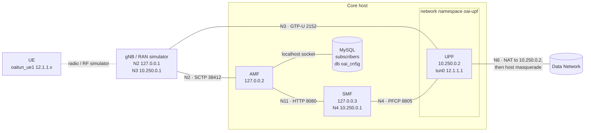

# Deploy the OAI 5G Core Network (AMF, SMF, UPF) from a package

This tutorial takes you from an empty machine to a running 5G core with a UE
reaching the internet. The `oai-cn5g` package installs the OpenAirInterface
AMF, SMF and UPF as one systemd service, with one config file and a local
subscriber database. It runs without an NRF: the AMF includes the AUSF/UDM
functions.

## What you get

| | |
|---|---|
| PLMN | MCC `001`, MNC `01` |
| TAC | `0x0001` (1) |
| Slices | SST 1 · SST 1 / SD 000001 · SST 222 / SD 00007B |
| DNN | `oai` (IPv4, UE addresses from 12.1.1.128/25) |
| Test UEs | IMSI `001010000000100` to `001010000000110` (11 UEs) |
| UE key (K) | `fec86ba6eb707ed08905757b1bb44b8f` (same for all test UEs) |
| UE OPc | `C42449363BBAD02B66D16BC975D77CC1` (same for all test UEs) |
| AMF (N2) | 127.0.0.2, SCTP port 38412 |
| UPF (N3) | 10.250.0.2, GTP-U port 2152 |

## Before you start

- **OS:** Ubuntu 24.04 (amd64 or arm64)
- `sudo` access, and internet access so the package manager can download the
  dependencies (MySQL or MariaDB, boost, SCTP and others).
- The package file for your system:

```
packages/
├── amd64
│   └── oai-cn5g_2.2.2+git20261009_amd64.deb
└── arm64
    └── oai-cn5g_2.2.2+git20261009_arm64.deb

2 directories, 2 files
```

### Connections



The gNB addresses shown are for a gNB on the same machine as the core (Step 4).

| NF | Address | Interfaces |
|---|---|---|
| AMF | 127.0.0.2 (`lo:amf`) | N2 SCTP 38412, SBI 8080 |
| SMF | 127.0.0.3 (`lo:smf`); N4 on 10.250.0.1 (`oaiupf-h`) | SBI 8080, N4 PFCP 8805 |
| UPF | 10.250.0.2 (`oaiupf-ns`), in network namespace `oai-upf` | N3 GTP-U 2152, N4 PFCP 8805, `tun0` 12.1.1.1 |

- **Created by the service:** the loopback addresses, the `oai-upf` network
  namespace and its veth pair (`oaiupf-h` ↔ `oaiupf-ns`) are set up when the
  service starts and removed when it stops.
- **Why a namespace:** the UPF's `tun0` and the UE address pool stay out of
  the host's routing table, so an OAI nrUE (`oaitun_ue1`) can run on the same
  machine.
- **UE traffic path:** UE traffic leaves through the UPF (source NAT to
  10.250.0.2), then the host (masquerade). The service turns on
  `net.ipv4.ip_forward`.

## Step 1: Install the package

```bash
# Ubuntu 24.04: use apt, not "dpkg -i", so that the dependencies are installed too.
# Run "apt update" first: without package lists (e.g. a fresh container), apt
# reports every dependency as "not installable".
sudo apt update
sudo apt install ./oai-cn5g_<version>_amd64.deb
```

The install:

1. installs MySQL (Ubuntu) or MariaDB (RHEL) and the other dependencies
2. creates the subscriber database `oai_cn5g` with the 11 test UEs
3. writes the configuration to `/etc/oai-cn5g/config.yaml`, with a random
   database password
4. enables and starts the `oai-cn5g` service

## Step 2: Check that the core is running

### Start and stop without systemd

Containers usually have no systemd, so the install cannot start the database
or the `oai-cn5g` service. It ends with
`oai-cn5g: no systemd here (container?); start the core with: sudo oai-cn5g-start`.

**Container requirements.** The core creates a network namespace, a veth
pair, `tun0`, NAT rules and loopback addresses. The container needs the
`NET_ADMIN` capability and `/dev/net/tun`, for example `docker run --privileged`.
Also start the container with an init process, for example `docker run --init`.
Without one, stopped NFs stay as zombie processes (harmless, but
`oai-cn5g-stop` then waits 10 seconds). Check the permissions with:

```bash
sudo ip netns add oai-test && sudo ip netns del oai-test && echo "netns OK"
ls -l /dev/net/tun
```

**Start.**

```bash
sudo oai-cn5g-start                  # log in /var/log/oai-cn5g.log
sudo oai-cn5g-start ~/oai-cn5g.log   # or a log file of your choice
```

`oai-cn5g-start`:

1. starts MySQL (or MariaDB) if it is not running
2. creates the subscriber database if it is missing
3. sets up the loopback addresses and the `oai-upf` namespace
4. starts UPF, SMF and AMF in the background

It waits until SMF and UPF are associated, then prints
`SMF and UPF are associated, AMF listens on 127.0.0.2:38412`.

**Check and follow the logs.**

```bash
tail -f /var/log/oai-cn5g.log
grep "N2 AMF IPv4" /var/log/oai-cn5g.log     # AMF listening for gNBs
grep Hash /var/log/oai-cn5g.log              # git commit of each NF
```

**Stop.**

```bash
sudo oai-cn5g-stop
```

This stops the three NFs and removes the namespace, veth pair, NAT rules and
loopback addresses. The database keeps running.

### Only when systemd is there

```bash
systemctl status oai-cn5g                    # should be "active (running)"
journalctl -u oai-cn5g | grep starting       # package version and git commits of AMF, SMF and UPF
journalctl -u oai-cn5g | grep Hash           # each NF's own version line: the git commit it was built from
```

Check that SMF and UPF are connected, and that the AMF is listening for gNBs:

```bash
journalctl -u oai-cn5g -t oai-smf | grep "ASSOCIATION SETUP RESPONSE"
#   ... [smf_n4 ] [info] Received N4 ASSOCIATION SETUP RESPONSE from an UPF
journalctl -u oai-cn5g -t oai-amf | grep "N2 AMF"
#   ... [ngap] [info] Set N2 AMF IPv4 Addr 127.0.0.2, port 38412
```

## Step 3: Add your UEs

Skip this step if you use the preloaded test UEs.

| IMSI | Key (K) | OPc |
|---|---|---|
| `001010000000100` | `fec86ba6eb707ed08905757b1bb44b8f` | `C42449363BBAD02B66D16BC975D77CC1` |
| `001010000000101` | `fec86ba6eb707ed08905757b1bb44b8f` | `C42449363BBAD02B66D16BC975D77CC1` |
| `001010000000102` | `fec86ba6eb707ed08905757b1bb44b8f` | `C42449363BBAD02B66D16BC975D77CC1` |
| `001010000000103` | `fec86ba6eb707ed08905757b1bb44b8f` | `C42449363BBAD02B66D16BC975D77CC1` |
| `001010000000104` | `fec86ba6eb707ed08905757b1bb44b8f` | `C42449363BBAD02B66D16BC975D77CC1` |
| `001010000000105` | `fec86ba6eb707ed08905757b1bb44b8f` | `C42449363BBAD02B66D16BC975D77CC1` |
| `001010000000106` | `fec86ba6eb707ed08905757b1bb44b8f` | `C42449363BBAD02B66D16BC975D77CC1` |
| `001010000000107` | `fec86ba6eb707ed08905757b1bb44b8f` | `C42449363BBAD02B66D16BC975D77CC1` |
| `001010000000108` | `fec86ba6eb707ed08905757b1bb44b8f` | `C42449363BBAD02B66D16BC975D77CC1` |
| `001010000000109` | `fec86ba6eb707ed08905757b1bb44b8f` | `C42449363BBAD02B66D16BC975D77CC1` |
| `001010000000110` | `fec86ba6eb707ed08905757b1bb44b8f` | `C42449363BBAD02B66D16BC975D77CC1` |

The AMF authenticates UEs against the `users` table of the `oai_cn5g`
database. It reads the table at every registration, so a new UE works
straight away, without restarting the core. On both MySQL and MariaDB, `root`
connects locally without a password.

Add a UE with the IMSI, key (K) and OPc from its SIM:

```bash
sudo mysql oai_cn5g -e "INSERT INTO users (imsi, \`key\`, sqn, rand, OPc) VALUES (
  '001010000000111',
  UNHEX('FEC86BA6EB707ED08905757B1BB44B8F'),
  0,
  UNHEX('00000000000000000000000000000000'),
  UNHEX('C42449363BBAD02B66D16BC975D77CC1'));"
```

- **IMSI:** must start with the network's PLMN, `00101`, unless you change
  the PLMN in Step 7.
- **Key and OPc:** 32 hex characters each (16 bytes), exactly as programmed
  in the SIM.
- **DNN and slice:** sessions use DNN `oai` with SST 1. These are set per DNN
  and slice in the config (`smf.local_subscription_infos`), not per UE.

List, change and delete UEs:

```bash
sudo mysql oai_cn5g -e "SELECT imsi, HEX(\`key\`), HEX(OPc) FROM users;"
sudo mysql oai_cn5g -e "UPDATE users SET OPc=UNHEX('<new OPc>') WHERE imsi='001010000000111';"
sudo mysql oai_cn5g -e "DELETE FROM users WHERE imsi='001010000000111';"
```

## Step 4: Connect a gNB and a UE

This step uses the OAI gNB and nrUE with the RF simulator, on the same machine
as the core. The package includes matching configs, already set to PLMN
001/01, TAC 1, AMF 127.0.0.2 and test UE `001010000000100`:

- `/usr/share/oai-cn5g/examples/gnb.conf`
- `/usr/share/oai-cn5g/examples/nr-ue.conf`

The settings in these files that must match the core:

```
# gnb.conf
tracking_area_code = 1;
plmn_list = ({ mcc = 001; mnc = 01; mnc_length = 2; snssaiList = ({ sst = 1, sd = 0xffffff }) });
amf_ip_address = ( { ipv4 = "127.0.0.2"; } );
NETWORK_INTERFACES : {
  GNB_IPV4_ADDRESS_FOR_NG_AMF = "127.0.0.1";
  GNB_IPV4_ADDRESS_FOR_NGU    = "10.250.0.1";   # any non-loopback address of this host
  GNB_PORT_FOR_S1U            = 2152;
};

# nr-ue.conf
uicc0 = {
  imsi = "001010000000100";
  key  = "fec86ba6eb707ed08905757b1bb44b8f";
  opc  = "C42449363BBAD02B66D16BC975D77CC1";
  pdu_sessions = ({ dnn = "oai"; nssai_sst = 1; });
};
```

```bash
cd ~/openairinterface5g/cmake_targets/ran_build/build
sudo ./nr-softmodem -O /usr/share/oai-cn5g/examples/gnb.conf -E --rfsim
sudo ./nr-uesoftmodem -O /usr/share/oai-cn5g/examples/nr-ue.conf -E --rfsim \
     -r 106 --numerology 1 -C 3619200000 --rfsimulator.[0].serveraddr 127.0.0.1
```

After 10 to 30 seconds the UE is registered and has an IP address:

```bash
ip addr show oaitun_ue1                                              # e.g. 12.1.1.130
```

## Step 5: Test the data path

```bash
ping -I oaitun_ue1 -c 4 12.1.1.1     # UPF tun0
ping -I oaitun_ue1 -c 4 8.8.8.8      # internet, through gNB -> UPF -> host
```

`-I oaitun_ue1` forces the ping through the UE. With the RF simulator, the
round-trip time is only a few milliseconds higher than a direct ping; real
radio hardware adds more.

## Step 6: Change the configuration

All three NFs read `/etc/oai-cn5g/config.yaml`. After an edit, run
`sudo systemctl restart oai-cn5g`. The comments at the top of the file list
the addresses.

- **Change the PLMN or TAC:** edit `amf.served_guami_list` and
  `amf.plmn_support_list`. Use the same values in the gNB config, and IMSIs
  that start with the new MCC and MNC.
- **Keep the first DNN:** the DNN with subnet `12.1.1.0/26` must stay first
  in `dnns:`. The UPF takes its `tun0` address from the first DNN, and UEs
  can reach `tun0` only when that address ends in `.1`.
- **Upgrades keep your edits.** The file is readable by root only, because
  it holds the database password.

## Everyday commands

```bash
sudo systemctl start|stop|restart|status oai-cn5g
journalctl -u oai-cn5g -f                     # all NFs, live
journalctl -u oai-cn5g -t oai-amf             # one NF: oai-amf, oai-smf or oai-upf
sudo ip netns exec oai-upf ip addr            # inside the UPF namespace
cat /usr/share/oai-cn5g/build-info            # package version and git commits
```

If any NF exits, the service stops the other two and systemd restarts all
three.


## Troubleshooting

| Symptom | What to check |
|---|---|
| `dpkg -i` reports missing dependencies | Install with `sudo apt install ./<file>.deb`. On Ubuntu 22.04 it cannot work; use 24.04. |
| `apt install` says dependencies are "not installable" | Run `sudo apt update` first (fresh systems and containers have no package lists). Check `dpkg --print-architecture` matches the package (amd64/arm64) and the OS is Ubuntu 24.04 (noble). |
| The gNB does not connect (no NG Setup) | `amf_ip_address` is 127.0.0.2 (or the core host); the PLMN is 001/01 and TAC 1 in the gNB config. |
| The UE is rejected or does not register | The IMSI is in the `users` table (Step 3), the key and OPc match the SIM, and the PLMN matches. See `journalctl -u oai-cn5g -t oai-amf`. |
| `ping 12.1.1.1` fails but the internet works | The first DNN in `dnns:` must be `12.1.1.0/26` (Step 7). |
| No internet from the UE | The host has a default route; `sysctl net.ipv4.ip_forward` is 1; `sudo iptables -t nat -S POSTROUTING` shows the MASQUERADE rule for 10.250.0.0/30. With firewalld, `oaiupf-h` must be in the `trusted` zone (the service does this). |
| RHEL: the database was not created at install | MariaDB was not running. Start it (`sudo systemctl enable --now mariadb`), then run `sudo /usr/lib/oai-cn5g/oai-cn5g-db`. |

## Uninstall

```bash
sudo apt remove --autoremove oai-cn5g        # Ubuntu; without --autoremove, MySQL and the libraries stay
sudo dnf remove oai-cn5g                     # RHEL; dnf also removes the dependencies it installed
```

This removes the binaries, the service, `/etc/oai-cn5g`, the `oai_cn5g`
database and its user, the `oai-upf` namespace, the veth pair and the
loopback addresses. MySQL's own data directory (`/var/lib/mysql`) stays
unless you purge the server package.

## License

Collaborative Standards Software License v1.0 (CSSL), the license of the OAI
repositories. The license text is installed in
`/usr/share/doc/oai-cn5g/copyright` (deb) or
`/usr/share/licenses/oai-cn5g/LICENSE` (rpm). Bundled third-party components
are listed in `/usr/share/doc/oai-cn5g/NOTICE.*`.
