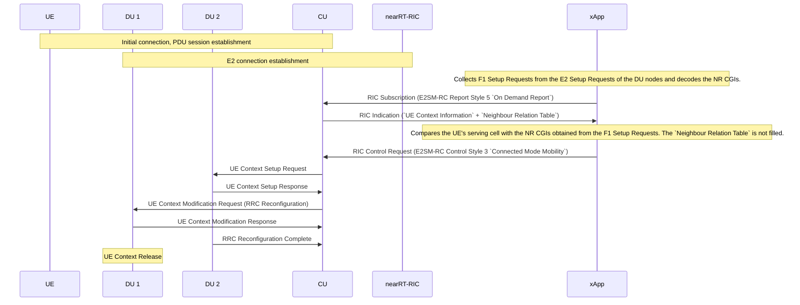
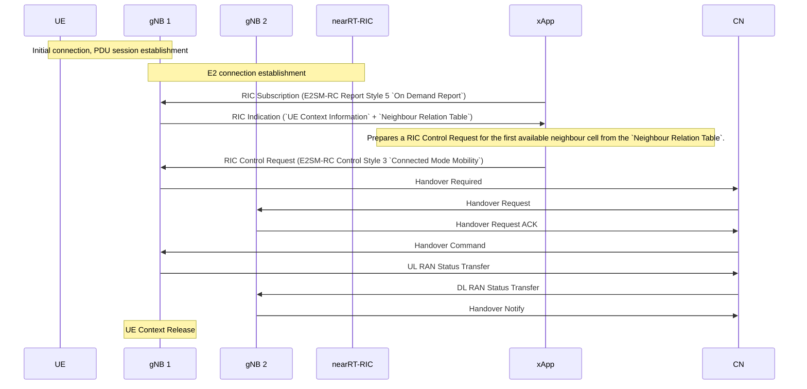

# North Carolina State University Hackathon 2026 — Topic 4: FlexRIC Traffic Steering Use Case

## Problem Statement

Traffic steering (TS) decides which cell, carrier, band, or access technology serves each UE (or each flow), so that the network meets a given goal such as throughput, load balancing, latency, energy efficiency, or QoS. Legacy RANs do this with fixed, cell-local rules: A3/A5 handover thresholds, Cell Individual Offsets (CIOs), and idle-mode reselection priorities. O-RAN aims to make steering UE-specific, data-driven, and closed-loop.

## Objective

Traffic steering can act through several levers, for example:
- **Handover** – bias a UE toward a less-loaded neighbor cell
- **Carrier/band selection** – move a UE from a congested 3.5 GHz carrier to 700 MHz
- **Dual-connectivity bearer split** – route a DRB through the SN instead of the MN, or change the split ratio
- **Slice-aware steering** – keep URLLC flows on low-latency cells
- **Idle-mode priorities** – set reselection priorities via RRC Release or SIBs
- **Multi-RAT (ATSSS)** – steer, switch, or split traffic across 3GPP and Wi-Fi access

In this hackathon, we focus on **handover**. The goal is to take the existing handover xApp, `xapp_rc_handover`, and extend it to handle more realistic scenarios. Today, the xApp supports only a single UE and requires no traffic: it triggers the handover as soon as it is launched, without any prior knowledge of the network state.

## Prerequisites

Recommended specifications:
- 3GPP TS 28.552 V18.01.0 – 5G performance measurements
- `O-RAN.WG3.E2GAP-v02.00` – nearRT-RIC architecture and E2 General Aspects and Principles; useful for a general understanding of E2
- `O-RAN.WG3.E2AP-v02.00` – E2AP protocol description
- `O-RAN.WG3.E2SM-KPM-v02.03` – E2SM-KPM service model description
- `O-RAN.WG3.E2SM-RC-v01.03` – E2SM-RC service model description

Assumed technical skills:
- Good knowledge of C and git
- Basic familiarity with the OAI codebase, notably the rfsimulator

## Starting Point

- Repository: https://github.com/duranta-project/openairinterface5g
- Branch: `develop`

Build OAI with the E2 agent enabled:
```bash
mkdir build && cd build && cmake .. -GNinja -DE2_AGENT=ON
ninja nr-softmodem nr-uesoftmodem rfsimulator params_libconfig
```

If everything runs on the same machine, you can use the FlexRIC submodule as the nearRT-RIC and xApp framework (in addition to its use as the E2 agent), instead of cloning the standalone [FlexRIC repository](https://github.com/duranta-project/flexric). To build and install it:
```bash
cd openairinterface5g/openair2/E2AP/flexric
mkdir build && cd build && cmake .. -GNinja
ninja
sudo ninja install
```

### Current handover flows

**F1 handover** (intra-CU, between two DUs):

Note: F1 handover in a disaggregated RAN (2 CU-CPs, 2 CU-UPs, 2 DUs) is handled the similar manner.

**N2 handover** (between two gNBs):


## Helpers & Resources

### (Optional) Wireshark
Per `O-RAN.WG3.E2GAP-v02.00` specifications, no SCTP port is specified for E2AP protocol. In our implementation, we use port number 36421.

### 5G Core

```bash
cd doc/tutorial_resources/oai-cn5g
docker compose up -d
# When running both gNBs on the same machine, assign a unique
# IP address to the second gNB to avoid network conflicts.
sudo ip addr add 192.168.71.180/24 dev oai-cn5g
```

### RAN

**F1 handover:**
```bash
cd openairinterface5g/build
# Run each of the following commands in a separate terminal
sudo ./nr-softmodem -O ../targets/PROJECTS/GENERIC-NR-5GC/CONF/gnb-cu.sa.f1.conf
sudo ./nr-softmodem --rfsim -O ../targets/PROJECTS/GENERIC-NR-5GC/CONF/gnb-du.sa.band78.106prb.rfsim.pci0.conf --rfsimulator.[0].serveraddr 127.0.0.1
sudo ./nr-uesoftmodem -r 106 --numerology 1 -C 3450720000 --rfsim --uicc0.imsi 001010000000001 -O ../ci-scripts/conf_files/nrue.uicc.conf --rfsimulator.[0].serveraddr server
sudo ./nr-softmodem --rfsim -O ../targets/PROJECTS/GENERIC-NR-5GC/CONF/gnb-du.sa.band78.106prb.rfsim.pci1.conf --rfsimulator.[0].serveraddr 127.0.0.1
```

**N2 handover:**
```bash
cd openairinterface5g/build
# Run each of the following commands in a separate terminal
sudo ./nr-softmodem -O ../targets/PROJECTS/GENERIC-NR-5GC/CONF/gnb.sa.band78.fr1.106PRB.pci0.rfsim.conf --gNBs.[0].min_rxtxtime 6 --rfsim --rfsimulator.[0].serveraddr 127.0.0.1
sudo ./nr-uesoftmodem -r 106 --numerology 1 -C 3619200000 --rfsim --uicc0.imsi 001010000000001 -O ../ci-scripts/conf_files/nrue.uicc.conf --rfsimulator.[0].serveraddr server
sudo ./nr-softmodem -O ../targets/PROJECTS/GENERIC-NR-5GC/CONF/gnb.sa.band78.fr1.106PRB.pci1.rfsim.conf --rfsim --gNBs.[0].min_rxtxtime 6 --rfsimulator.[0].serveraddr 127.0.0.1 --gNBs.[0].NETWORK_INTERFACES.GNB_IPV4_ADDRESS_FOR_NG_AMF 192.168.71.180 --gNBs.[0].NETWORK_INTERFACES.GNB_IPV4_ADDRESS_FOR_NGU 192.168.71.180
```

### FlexRIC

```bash
cd openairinterface5g/openair2/E2AP/flexric
# Run each of the following commands in a separate terminal
./build/examples/ric/nearRT-RIC
./build/examples/xApp/c/rc_handover/xapp_rc_handover
```

### (Optional) Tools & Frameworks

You can use an SQLite database together with Grafana to observe E2SM-KPM/E2SM-RC data. Install Grafana following the [official installation instructions](https://grafana.com/docs/grafana/latest/setup-grafana/installation/), then run:
```bash
sudo grafana-cli plugins install frser-sqlite-datasource
sudo vi /etc/grafana/grafana.ini # set min_refresh_interval to 1s
sudo systemctl start grafana-server
DB_DIR=/db_dir/ && sudo mkdir $DB_DIR && sudo chown -R "$USER":"$USER" $DB_DIR
```

To import the Grafana configuration:
- Open Grafana in your web browser at `http://localhost:3000`.
- In `Connections > Data Sources`, click `Add new data source` and choose `SQLite`. Set the path to `DB_DIR/DB_NAME`, then save and test the connection.
- In `Dashboards > New > Import`, upload the `grafana/dashboards/grafana-dashboard.json` file and select the SQLite data source you just created.

## Tasks

1. Connect multiple UEs to the same DU/gNB, using `doc/NR_SA_Tutorial_OAI_multi_UE.md` as a reference.
2. Extend the `xapp_rc_handover` xApp with E2SM-KPM measurements so that it supports more than one UE.
3. Generate traffic for all UEs. Observe the load in the xApp and, optionally, in Grafana.
4. Recompile OAI with telnet support and modify the UE's serving-cell RSRP at run time. Extend the xApp to support E2SM-RC REPORT Service Style 1.
   * Note: For E2SM-RC grafana dashboard, the values are displayed per RRC Measurement Report, not per UE. If you would like to vizualize per UE, then the source code shall be adjusted in E2 agent, xApp and `src/xApp/db/sqlite3/sqlite3_wrapper.c`. The reason it hasn't been done earlier is that the specification has a limitation.
5. Design your own policy for handover decisions. The previous steps are enough to build a basic policy, but feel free to go further: use any additional information you can gather, implement a new E2SM-KPM measurement, or add a new E2SM-RC REPORT/INSERT/CONTROL/POLICY service style.

## Expected Result

The xApp triggers handovers for the UEs that need them, without degrading their QoS.

## Validation / Evaluation

Present a demo in which the xApp makes handover decisions autonomously, without manual intervention, and keeps operating beyond a single run.

## Deliverables

Submit the following by sending an e-mail to <oaicicdteam@openairinterface.org>:

- Source code links, forked from [duranta-project/openairinterface5g](https://github.com/duranta-project/openairinterface5g) and [duranta-project/flexric](https://github.com/duranta-project/flexric)
   * Note: Keep the commit history clean and concise.
- A README.md describing:
   * the approaches considered
   * the challenges faced
   * the final approach, with the commands needed to reproduce the scenario
   * which AI tools were used (if any), and for what
- A demo video

## Support

- Teodora Vladić <teodora.vladic@openairinterface.org>
- Andrea Lacava <a.lacava@northeastern.edu>
