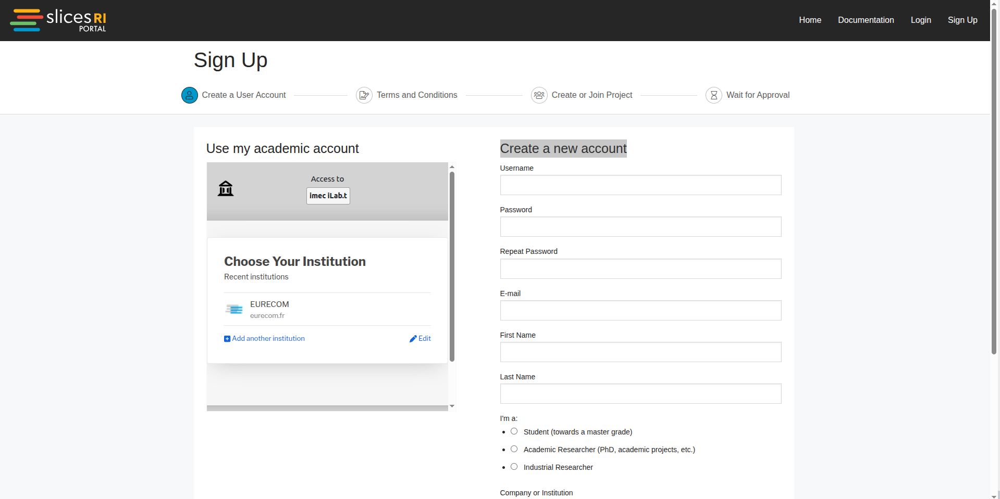
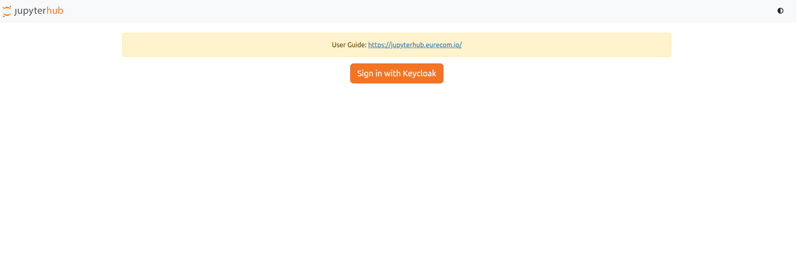
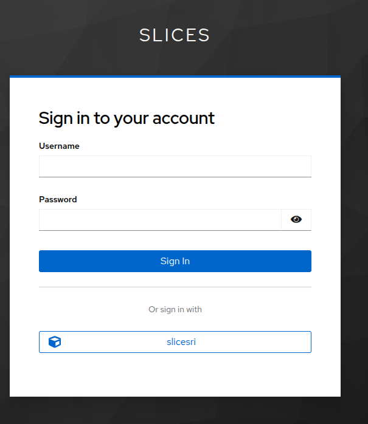
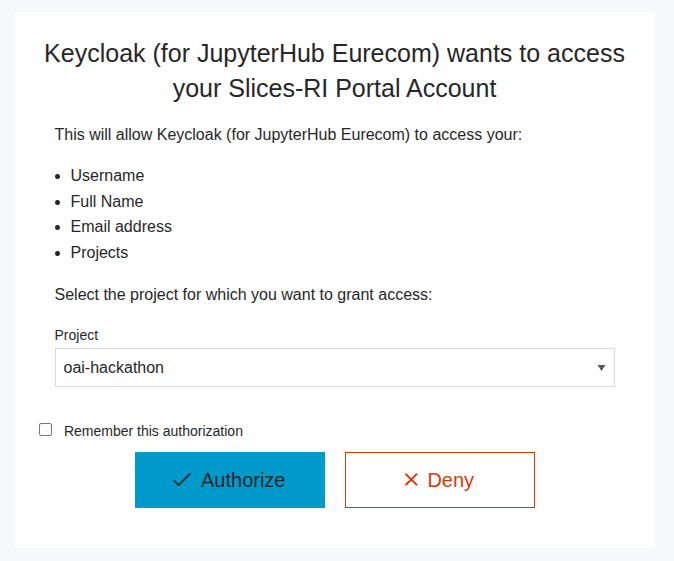
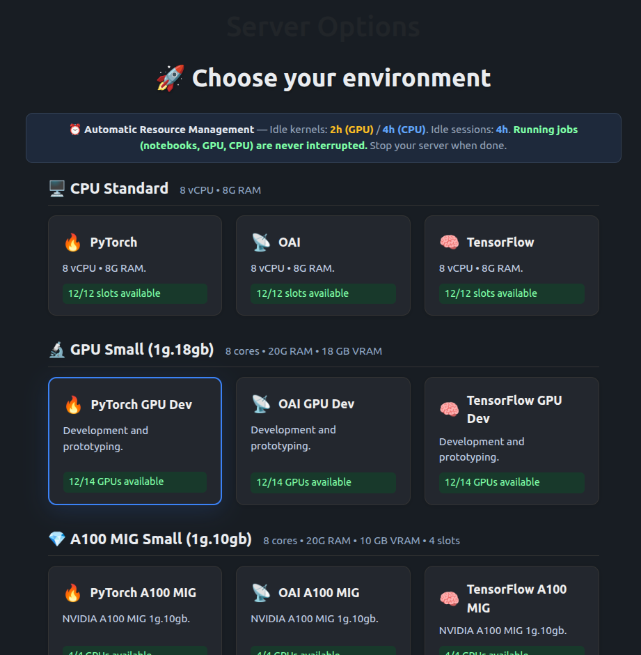
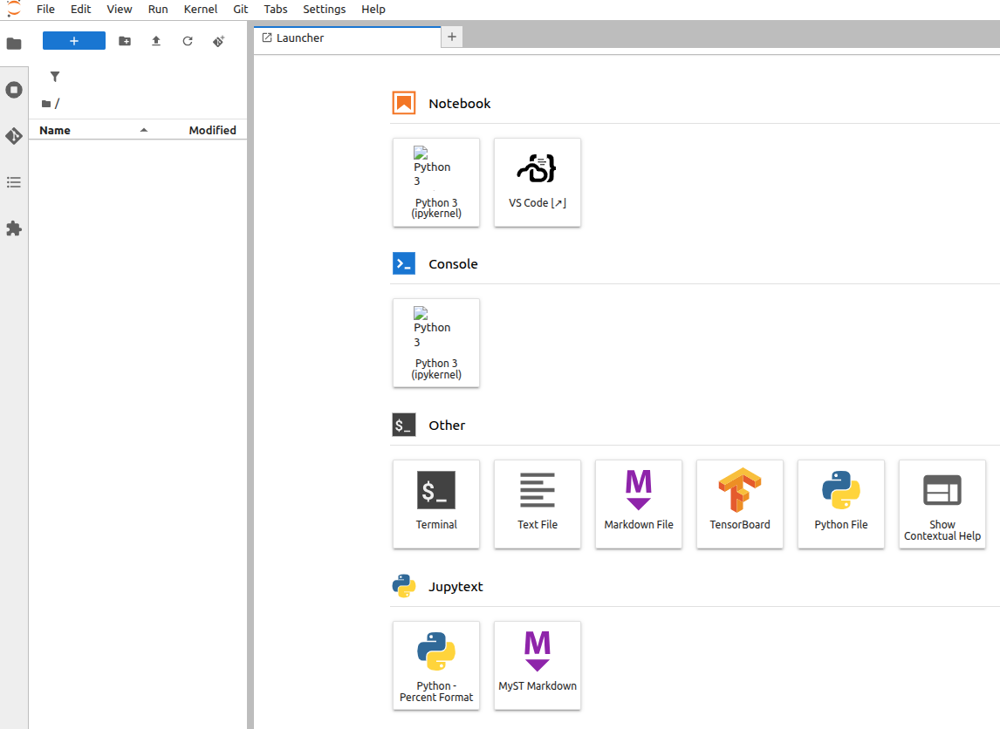

# Hackathon Infrastructure

The hackathon infrastructure is provided by [Slices RI Project](https://www.slices-ri.eu/)

**Slices project**: SLICES is a flexible platform designed to support large-scale, 
experimental research focused on networking protocols, radio technologies, 
services, data collection, parallel and distributed computing 
and in particular cloud and edge-based computing architectures and services.

The compute resources is a JupyterHub Notebook (running in a Kubernetes Pod) 
which provides a Web-console, VSCode terminal.

Available resources:

1. CPU Standard (X86): 
  - 8 vCPU
  - 8Gi RAM
  - Total 12 Pods available
2. GPU Small (1g.18gb)(ARM64/Gracehopper H200)
  - 8 vCPU
  - 20Gi RAM
  - 18GB VRAM
  - Total: 14 Pods available
3. A100 MIG Small(1g.10gb)(x86, A100 GPU)
  - 8 vCPU
  - 20Gi RAM
  - 10GB VRAM
  - Total: 4 Pods available

GPU resources are reserved for Topics which require GPU

## Create An Account On Slices Portal

To access the Jupyter notebook you need to create an account on
[Slices Portal](https://portal.slices-ri.eu/signup). You can login
using your university credentials. You will see "Use my academic account"
if you are not able to then use "Create a new account".

When asked for a project write **oai-hackathon**. You will receive
a verification email it will be sent to your inbox or spam folder.

Once your email is verified then your slices account is valid.

You will need to wait for 5-10 mins to get your project request validated.

For now this account is only used as an **Authentication Mechanisim**.

## Login to Jupyter NoteBook

**Webpage**: https://jupyterhub.slices.cs.eurecom.fr/hub/login

Click on "Sign in with Keyclock"

Select sign-in with **slicesri**

Put the slices credentials you just used, select the project **oai-hackathon**.

Click on start server and select the server of you want.

Once you will start a server you landing page will look something like below

## Work environment

You can work on the web terminal and upload files from your local desktop to this system.

In case of issues send an email at sagar.arora@openairinterface.org
