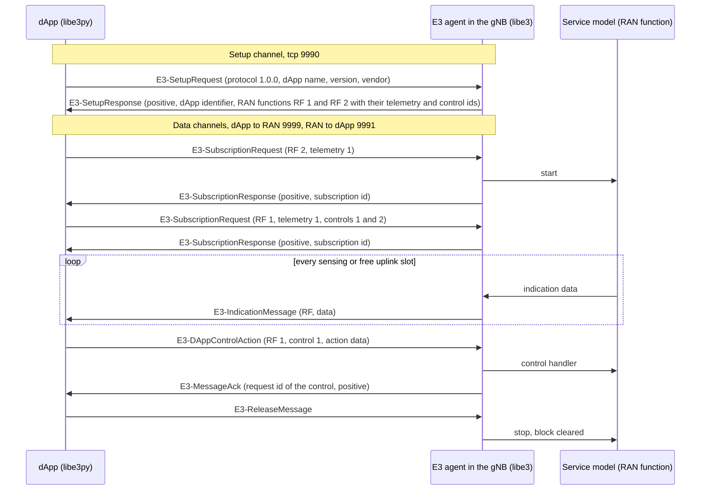
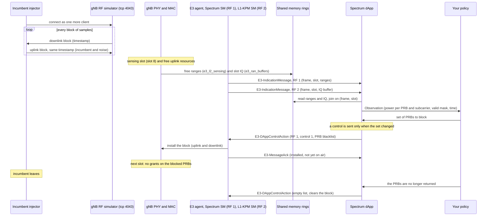

# North Carolina State University Hackathon 2026 — RAN Control dApps

## Problem Statement

A gNB that shares spectrum with an incumbent (for example a radar) must stop using the affected
frequencies as soon as the incumbent appears, release them when it leaves, and keep serving its UEs
on everything else.

A **dApp** is a real-time application that runs next to the gNB and talks to it over the **E3**
interface. It sees measurements the near-RT RIC cannot (per-slot IQ), and it can act on the MAC
scheduler within milliseconds. Here the gNB senses the uplink band, streams the spectrum to your dApp,
and applies the PRB blacklist the dApp sends back.

## Objective

Write a **spectrum sharing** dApp that performs dynamic PRB-nulling to ensure gNB-incumbent coexistence.
Your policy should be robust enough to work against dynamic incumbents that might transmit in different portions of the spectrum at the same time.

**Do not break the UE.** The gNB applies whatever your dApp blocks, in UL and DL, including the PRBs its own
control channels live on. Block the UE's PUCCH or the PRACH and the UE can no longer ask for grants or attach:
it drops, and a dropped UE costs you more than a missed incumbent. The measurements are not perfectly clean
either: some of the UE's own control-channel energy can show up in them and look like an incumbent. Telling the
two apart is part of the challenge.

You start from a stub class (`examples/hackathon_policy.py`, method `update()`), but you are free to
go further: you have the full dApp and the full OAI code and may modify both.

The incumbent signals and the noise injection represent the possible scenarios your dApp should react to.

## Prerequisites

Knowledge in the following areas is helpful:

- Python and numpy (signal processing)
- Building and running OAI code
- 5G NR basics: PRBs, 30 kHz subcarrier spacing, TDD slots

Software and hardware:

- Ubuntu 24.04 (minimum), Python 3.12, Docker with `docker compose`
- C++17 compiler, CMake >= 3.16, SWIG >= 4.0, `nlohmann-json3-dev`, `libzmq3-dev`
- 8 cores, 16 GB RAM, 30 GB free disk (the OAI build alone is about 10 GB)

**libe3**, the E3 protocol library that the gNB and the dApp use, installed once like any other library: it asks
for `sudo`, and nothing after it does:

```bash
git clone --branch 0.2.3 https://github.com/wineslab/libe3 ~/libe3
cd ~/libe3
./build_libe3 -I                          # build dependencies, first time only
./build_libe3 --all-encodings --install   # into /usr/local
pkg-config --modversion libe3             # 0.2.3
```

`--all-encodings` builds ASN.1, JSON and Protocol Buffers: the gNB serves whichever one the dApp uses.

## Starting Point

* Repository: https://github.com/duranta-project/openairinterface5g (gNB), https://github.com/wineslab/dApp-library (dApp), https://github.com/wineslab/libe3 (E3 library)
* Branch/tag: OAI pull request #495, `dApp-library` tag `0.3.0`, `libe3` tag `0.2.3`
* Configuration: provided in this directory: `conf/` (gNB with the E3 agent, UE), `scenarios/` (ten sample incumbents and the noise floor), `tools/` (injector, scenario generator, scoring)
* Test environment: locally, RF simulator (no radio), OAI 5G Core in Docker, one UE

### Current E3 flows

**E3AP between the dApp and the gNB.** The E3 agent in the gNB and the dApp (through `libe3py`) exchange E3AP
messages over three TCP ports (ZMQ): setup on 9990 (request/reply), dApp to RAN on 9999, RAN to dApp on 9991.
Two service models (RAN functions) are registered: RF 1 *Spectrum SM* (telemetry 1 to 5; controls 1, PRB
blacklist, and 2, sensing policy) and RF 2 *L1-KPM SM* (telemetry 1, 4, 5 and 6). The first subscription starts a
service model, the last release stops it and clears its block. Every request is answered with an
`E3-ResponseCode` (`positive` or `negative`; a refused setup is a `negative` response).



**Spectrum sharing in this challenge.** The injector is one more RF simulator client of the gNB: for every block
of downlink samples the gNB sends, it answers with the uplink block that carries the incumbent and the noise.
The gNB's MAC reserves slot 8 of every TDD period for sensing and leaves the unused part of the other uplink
slots free, writes the free resources and the IQ of the slot into two shared-memory rings, and announces each slot
with an indication. The dApp joins the two on `(frame, slot)`, hands your policy the observation, and sends the
PRB set it returns as a control. A new control replaces the previous set, and an empty list clears it.



The dashboard (below) gets the same slots over ZMQ from the dApp and your block set goes the other way; none of that is
part of the E3 exchange. On the reference setup a block is on air about 20 ms after the incumbent appears, and the
release follows about a second after it leaves with `ReferencePolicy`.

## Helpers & Resources

**Start order.** Each in its own terminal: 5G Core, gNB, then the **noise floor**, then the UE, then your dApp.
The RF simulator adds no noise of its own, and on a noiseless channel the UE's own control channel (PUCCH, at
the lowest PRBs) looks like an incumbent; a policy that blocks those PRBs cuts the UE off. So keep a
background noise source connected for the whole session (*Noise floor*, below).

### 5G Core

```bash
cd ~/oai-workshops/cn
docker compose pull
docker compose -f docker-compose.yml up -d
docker compose -f docker-compose.yml ps -a            # wait until every container is healthy
```

If the pull is denied (`ghcr.io ... denied`), a stale `docker login` for `ghcr.io` is the usual cause: the images
are public, so `docker logout ghcr.io` fixes it.

Once the UE is attached: `ping -I oaitun_ue1 192.168.70.135`. For uplink traffic start the iperf3 server once
(`docker exec oai-ext-dn iperf3 -s -D`), then `iperf3 --bind-dev oaitun_ue1 -c 192.168.70.135 -u -b 5M -t 120`.
Stop the core with `docker compose -f docker-compose.yml down -t2`.

### RAN

Clone and check out (everything below assumes your home directory):

```bash
git clone https://github.com/openairinterface/workshop ~/oai-workshops
git -C ~/oai-workshops checkout hackathon-2026
git clone https://github.com/duranta-project/openairinterface5g ~/openairinterface5g
cd ~/openairinterface5g
git fetch origin pull/495/head:e3-prb-blocking && git checkout e3-prb-blocking
```

Build (needs libe3, see Prerequisites):

```bash
source oaienv && cd cmake_targets
./build_oai -I                                         # first time only
./build_oai -w SIMU --ninja --gNB --nrUE --build-e3
```

Run the gNB (configuration with the E3 agent in `conf/`). `-E` selects the 46.08 Msps rate that the dApp
and the injector use; the UE must use it too:

```bash
cd ~/openairinterface5g/cmake_targets/ran_build/build
rm -f /dev/shm/e3_ran_buffers /dev/shm/e3_l2_sensing; sudo rm -rf /tmp/dapps       # state of a previous run
./nr-softmodem -O ~/oai-workshops/hackathons/ran-control-dapps/conf/gnb.sa.band78.106prb.rfsim.e3.conf \
  --rfsim -E 2>&1 | tee /tmp/gnb.log
```

Run the UE:

```bash
sudo ./nr-uesoftmodem -C 3619200000 -r 106 --numerology 1 --ssb 516 \
  -O ~/oai-workshops/hackathons/ran-control-dapps/conf/ue.conf --rfsim -E
```

What to look for in `/tmp/gnb.log`: `Init E3 Agent`, `Sensing slot reserved`, and after your dApp sent a
control `[SPECTRUM-SM] prbBlock: set UL+DL mask n_prbs=1 PRBs=[72] -> ok=1` and
`[PRB-BLOCK] active blocked PRBs`. `ok=0` means the control was rejected.

The carrier has 106 PRBs of 360 kHz. Point A is 3600.12 MHz, so PRB `k` covers
`3600.12 + 0.36 k` to `3600.12 + 0.36 (k+1)` MHz and the carrier centre is 3619.2 MHz.
The dApp always ignores the PRBs next to the centre (50 to 56).

### Tools & Frameworks

**dApp library**, in a virtual environment (no `sudo`). Its E3 binding, `libe3py`, comes from PyPI as a
dependency and is built against the libe3 from the Prerequisites. Install it editable, from a clone, because the
file you edit is in it:

```bash
python3 -m venv ~/dapp-venv && source ~/dapp-venv/bin/activate
git clone --branch 0.3.0 https://github.com/wineslab/dApp-library ~/dApp-library
cd ~/dApp-library && pip install -e ".[gui]"            # [gui]: the dashboard
```

**Your dApp.** The stub is `examples/hackathon_policy.py` in the clone:

```python
class MyPolicy(Policy):
    def update(self, obs: Observation) -> set[int]:
        return set()          # the PRBs to block; the ones you leave out are released
```

`obs.prb_power_db` is one level per PRB (dB, relative to the gNB's FFT counts, not dBm), `obs.power_db` one
per subcarrier, `obs.valid` marks what was measured, `obs.t` is the time, and `self.history` holds the last
observations; keep any other state on `self`. An observation arrives every few milliseconds (about 6.7 ms nominal, depending on how fast the simulator runs). Observations contain
only the resources the MAC left free of UE transmissions (the sensing slot and the unused part of the other UL
slots), not the UE's data; some of the UE's PUCCH energy at the lowest PRBs can still show up (see the note
below). `ReferencePolicy` in the same file is a simple working policy to compare against.
Run your policy (from `~/dApp-library`), with the dashboard:

```bash
source ~/dapp-venv/bin/activate
python3 -m examples.spectrum_dapp --link zmq --transport tcp --encoding-method asn1 --control \
  -ru rfsim --num-prbs 106 --center-freq 3619200000 --e --policy examples.hackathon_policy:MyPolicy --demo-gui
```

The dApp logs to `/tmp/dapp.log` (`Detected PRBs`, `[LATENCY]`). The gNB and the dApp must use the same
`link`, `transport` and `encoding`, and `--e` goes with the gNB's `-E`.

> **NOTE**: the gNB does not protect its control channels from your blocks. The UE's PUCCH and the PRACH sit at
> the lowest PRBs (0 to about 11 in this cell). Blocking them drops the UE: the gNB logs
> `new block hits configured PUCCH`, then `Cannot schedule SR` and `Detected UL Failure`, and the UE goes back to
> random access, which fails for as long as the block stays. Energy at those PRBs can be the UE itself, so treat
> it with care. The scorer counts a dropped UE (see Validation / Evaluation).

**Dashboard.** `--demo-gui` serves it on port 5001 of the machine running the dApp (`http://<that machine>:5001`;
from your laptop, `ssh -L 5001:localhost:5001 <machine>` and `http://localhost:5001`). It shows the spectrum
density and a waterfall of the UL symbols the gNB receives. With *L1xL2 filter: on* (the default, in the
*Detector* panel) it shows exactly what your policy sees: only the resources the MAC left free of UE
transmissions, slot by slot, everything else dark. Set the filter to *off* to see the UE's own transmissions
too (run a ping and you will see it); your policy never sees those. The frequency axis is in MHz, and hovering
over a plot shows the PRB, subcarrier and frequency under the cursor. The *BLOCKED* strip above the waterfall
shows the PRBs your policy blocks. The *Spectrum SM* panel switches the forwarding of your blocks to the gNB on
and off, the *Detector* panel only reports the policy (its parameters live in your code), and the *Visualizer*
and *SigMF Recording* panels work as labelled (the recording is large, about 160 MB/s with one antenna).

**Noise floor.** Build the injector once; it connects to the running gNB as one more RF simulator client:

```bash
make -C ~/oai-workshops/hackathons/ran-control-dapps/tools/incumbent-injector      # once
cd ~/oai-workshops/hackathons/ran-control-dapps
tools/incumbent-injector/incumbent-injector --scenario scenarios/noise_floor.json --sample-rate 46080000
```

It runs until you stop it (`--noise-dbfs` changes the level, -60 dBFS by default).

**Incumbents and scoring.** The ten samples in `scenarios/` are fixed examples: `incumbent1_tone` to
`incumbent5_weak`, and `seed1_level1` to `seed2026_level5`, which `tools/generate_scenario.py` made for five seeds.
The generator makes a random scenario from a **seed** and a **level** (1 easy to 5 hard) and gives the same one for
the same numbers on every machine. At the demo you will be given the seeds.
With the gNB, the noise floor, the UE and your dApp running, in another terminal:

```bash
cd ~/oai-workshops/hackathons/ran-control-dapps
tools/run_scenario.py scenarios/incumbent1_tone.json --gnb-log /tmp/gnb.log [--noise-dbfs -50]
tools/run_scenario.py --seed 4711 --level 3 --gnb-log /tmp/gnb.log          # a generated scenario
tools/generate_scenario.py --seed 4711 --level 3 --show                      # only look at it
```

The injector connects to the running gNB as one more RF simulator client and adds the incumbent, and the
scenario's own noise on top of the noise floor, to the uplink. It runs the scenario in real time (about two
minutes), then prints the metrics and writes the ground truth and the score to `results/`. To score a run, start
the gNB with `--log_config.global_log_options level,nocolor,time` (the score is matched with the log's
timestamps). Every scenario has a quiet period before and after the incumbents. With the noise at -60 dBFS the
per-PRB level is about 29 dB, and a -40 dBFS tone in one PRB reads about 60 dB. `run_scenario.py` also runs a
5 Mbit/s uplink iperf3 flow from the UE for the whole scenario (start the iperf3 server once as in the 5G Core
section; `--no-iperf` skips it) and the score includes the share of it that is delivered.

## References (optional)

* Documentation: `openair2/E3AP/README.md` and `openair2/E3AP/service_models/spectrum_sm/SPECTRUM_SM_ARCHITECTURE.md` in OAI; the `libe3` README; the dApp library README and `src/spectrum/README.md`
* Specifications: O-RAN E3 interface (WG3), 3GPP TS 38.211 (resource grid)
* Example implementations: `examples/spectrum_dapp.py` and `src/spectrum/threshold_detector.py` in the dApp library
* Related repositories: https://github.com/wineslab/libe3, https://github.com/wineslab/dApp-library

## Tasks

1. Build everything and start the core, the gNB, the noise floor and the UE (in that order, see *Start order*); check that the UE has an IP and can ping.
2. Start the dApp with `ReferencePolicy` and the dashboard and observe what it sees; look at the per-PRB level of a quiet network at several noise levels (`--noise-dbfs` on the noise floor).
3. Run `incumbent1_tone` and `incumbent2_band` with the stub as it is (it blocks nothing) to get a baseline score, and watch the incumbent in the dashboard.
4. Implement your policy and run the ten samples and some generated seeds at every level, at several noise levels (`--noise-dbfs`, for example -70 to -40).
5. Improve it: faster, fewer wasted PRBs, robust when the signal is weak or moves, and never at the cost of the UE: run uplink traffic and check that the UE stays attached. Anything you change in the dApp or OAI is yours to keep.

## Expected Result

The gNB, with your dApp attached, blocks the PRBs an unknown incumbent uses within a fraction of a second,
releases them soon after it leaves, wastes as few other PRBs as possible, and keeps the UE traffic flowing.
This must hold without retuning when the incumbent, the seed and the noise level change.

## Validation / Evaluation

Present a **live demo** in which your dApp protects the incumbents autonomously, without manual intervention, on
the scenario **seeds announced at the event** (the samples in `scenarios/` are only examples), and keeps working
beyond a single run. Show the dashboard and the score of each run. `tools/score/score.py` compares the PRBs the
gNB blocked with the incumbent's ground truth:

- protection: share of the incumbent's PRBs that are blocked while it is active
- time to block and time to release
- over-blocking: PRB-seconds blocked that the incumbent does not use (also on a quiet run)
- UE survival: whether the UE stayed attached for the whole run (UL failures, random-access restarts); a dropped UE is the largest penalty
- UE uplink traffic: the share of an offered 5 Mbit/s UDP uplink flow (iperf3, started by `run_scenario.py`) that is delivered during the run

## Deliverables

Participants should submit the following to <oaicicdteam@openairinterface.org>:

1. **Links to the source code**: your forks of the OAI gNB and of the dApp library (GitHub, GitLab or any other
   repository, SVN included) with your policy and every change you made, patches are fine. Keep the commit history
   clean and concise.
2. **A `README.md`** in them that covers: the approaches you considered, the challenges (what went wrong and how
   you fixed it), the final approach with the commands to reproduce it (seeds and levels, noise levels, scores),
   and which AI tools you used, if any, and for what.
3. **A demo video**: a screen recording of a run with the dashboard and the score visible.
4. **A presentation** so that we can put on the website.

Any dApp policy, or any change to the OAI code that extracts more parameters from the RAN for the dApps, is welcome to be contributed to the original repositories after the hackathon.

## Support

Andrea Lacava <a.lacava@northeastern.edu>
