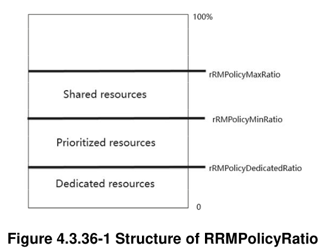

# North Carolina State University Hackathon 2026 — RAN MAC/RRM

## Problem Statement

In ISAC, and generally in 5G/6G networks, there is a resource tradeoff problem:
spectrum/time/power must be shared among UEs, but some services are more
important than others. Thus, slicing has been devised as a means to isolate
these services from each other.

3GPP incorporated the notion of slicing into the specifications via the NSSAI
(Network Slice Selection Assistance Information, see TS 38.300 §16.3) that is
signalled by each UE and serves as a basis to identify slices. Further,  3GPP
standardized, as part of the 5G Network Resource Model, the "RRMPolicyRatio"
(see TS 28.541 §4.3.36) which defines the amount of dedicated, prioritized
(min-ratio), and shared resources (max-ratio) that are allocated to each slice.



## Objective

Write a simple scheduler PRB policy that ensures a given percentage of
resources is reserved for a given UE. You start by running the existing branch
mac-rrm and connect 2 UEs with different slices. Observe what slices are
configured, and to which slices the UEs are associated. There are functions for
slice scheduling that are called when slicing is activated, namely
`nr_dl_slicing()` and `nr_ul_slicing()`.

The default configuration files provided (in this directory) configure
2 slices and 3 UEs, where the slices 1&2 have a min-ratio of 30% and 70%,
respectively, and UE_A is in slice 1, and UE_B and UE_C are in slice 2. You
could start by statically allocating resources to the UEs according to the
minimum resources configured. Then, extend the slice schedulers:

- implement dedicated and shared resources in addition to prioritized
- default (no slice) scheduling for UEs that do not match any configured NSSAI
- bonus: allow more fine-grained resource sharing than 5%.
- bonus: per-LC slice scheduling (currently limited to per-UE slice scheduling)

## Scope

Participants are required to modify the file `openair2/LAYER2/NR_MAC_gNB/slicing.c`
to implement a slicing algorithm that can fulfill the requirements.

Dynamic modification of slice parameters (e.g., through O-RAN E2 interface) is
out of scope, but a solution should no inhibit a dynamic configuration of
slices if participants wish to work on this.

## Prerequisites

Knowledge is assumed in these areas:

- Building and running OAI code
- Familiarity with C
- Concepts of slicing
- Optional: [OAI scheduler architecture](https://github.com/duranta-project/openairinterface5g/blob/develop/doc/MAC/scheduler-architecture.md)

During the hackathon, there will be time to exchange with the mentor to fill
knowledge gaps.

## Starting Point

* Repository: https://github.com/rorsc/openairinterface5g
* Branch/tag: mac-rrm-hackathon
* Configuration: OAI configuration provided further below
* Test environment: locally or on provided infrastructure, virtual radio

## Helpers & Resources

Configuration files for core network, RAN, and UEs to set up the basic scenario
are provided in this directory and are clearly marked.

```
docker compose up -d sliced-cn.yaml
./nr-softmodem -O gnb.conf
sudo ./nr-uesoftmodem -O ueX.conf
```

## References

* Documentation: [OAI scheduler architecture](https://github.com/duranta-project/openairinterface5g/blob/develop/doc/MAC/scheduler-architecture.md)
* Specifications:
  [TS 38.300](https://www.etsi.org/deliver/etsi_ts/138300_138399/138300/17.17.00_60/ts_138300v171700p.pdf),
  [TS 28.541](https://www.etsi.org/deliver/etsi_ts/128500_128599/128541/17.20.00_60/ts_128541v172000p.pdf)
* Related repositories: https://github.com/duranta-project/flexric
* Example implementations: see below.
* Further literature: the paper [NVS: a substrate for virtualizing wireless
  resources in cellular networks](https://dl.acm.org/doi/10.1109/TNET.2011.2179063)
  might be useful for inspiration.

There is existing prior work that participants might find useful to gather
ideas and check against existing implementations, including controller
interfaces:

- https://gitlab.eurecom.fr/oai/openairinterface5g/-/merge_requests/2458
  Suggestion of implementing the NVS algorithm, and support of O-RAN E2
  interface
- https://github.com/duranta-project/openairinterface5g/pull/451
  Frequency-domain slice scheduling with O-RAN E2 interface support, but does
  not respect the current scheduler architecture.

## Tasks

1. run the scenario of 2 slices and 3 UEs, observe/explain how slicing works.
2. implement a slicing algorithm that fulfills all requirements
3. demonstration of various scenarios

## Expected Result

The final slicing algorithm should be able to schedule slices according to
dedicated, prioritized, and shared resources, and allow fine-grained sharing of
resources.

Other MAC scheduler modifications should be kept to a minimum but are permitted
given they are well justified.

## Validation / Evaluation

Show how the different resources interact, and that UE resources are guaranteed
at any time.

The instructor has access to a multi-UE simulator with which the behavior
can be observed over the air.

## Deliverables

Participants should submit the following by sending an e-mail to oaicicdteam@openairinterface.org:

* a link to a fork of
  [rorsc/openairinterface5g](https://github.com/rorsc/openairinterface5g) or
  [duranta-project/openairinterface5g](https://github.com/duranta-project/openairinterface5g)
  that builds on top of branch hackathon-mac-rrm, with the implementation.
  Remember: less is more!
* a README.md that details:
  - Description of scenarios: show that dedicated, min, and max ratios of
    resources per slice are working.
  - Plots/visuals (optional): resource usage in "steady state".
  - Challenges: what went wrong and how you fixed it
  - AI tools used: which models or assistants you used (if any) and what for

Further, at the end of the hackathon, participants are required to do

* 5-10min presentation of the solution, and why it is correct.

## Support

Robert, on site. In case of need: robert.schmidt@openairinterface.org
