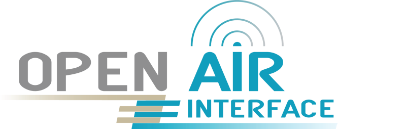

<table style="border-collapse: collapse; border: none;">
  <tr style="border-collapse: collapse; border: none;">
    <td style="border-collapse: collapse; border: none;">
      <a href="http://www.openairinterface.org/">
         
         </img>
      </a>
    </td>
    <td style="border-collapse: collapse; border: none; vertical-align: center;">
      <b><font size = "5">OpenAirInterface 5G Core Network Summer Workshop 2023</font></b>
    </td>
  </tr>
</table>

**What do we cover in the RAN Hands-On?**

The aim of this tutorial is to explain: 

1. Understand the code repository organization
2. Set-up of end-to-end 5G/NR SA setup with RFsimulator from source
4. Use of the scope(s) + basic channel modelling
5. Connection of multiple UEs
6. How to build docker containers of the RAN
7. Individually, also covered in demo: How to start with the DU-CU/F1 split

**Hardware Requirements**

1. A laptop or remote server with minimum 8vCPU and 16GB of RAM and 16GB of storage.  To avoid any problems, we expressly recommend the use of a physical machine, i.e., NO virtual machine.
2. Make sure your laptop/remote server cpu supports `avx2`. You can check via `lscpu | grep avx2`
3. Operating System: Ubuntu 20.04 or 22.04. Other operating systems might work (e.g., Fedora); some (Arch, ...) do not work
4. Note: macOS and new M1/M2 laptops are not yet tested

**Software Prerequisites**

none: we will install all the necessary software

**Reading time**: ~30mins

**Tutorial replication time**: ~90mins


**TABLE OF CONTENTS**

TODO


# Preparation for RAN training session

## Installation of dependencies and compilation

This step should be done before the hands-on training, i.e., at least you should install the RAN dependencies and compile it, as this takes some time.

```
$ cd 
$ git clone https://gitlab.eurecom.fr/oai/openairinterface5g.git
$ cd openairinterface5g/cmake_targets
$ git checkout develop
$ ./build_oai -I                               # install dependencies
$ ./build_oai --ninja --gNB --nrUE -w SIMU     # compile gNB and nrUE
```

Note: for USRP support, you have to give the switch `-w USRP`

## The RAN repository

- https://gitlab.eurecom.fr/oai/openairinterface5g
- Work happens in the `develop` branch
- Usually one integration branch per week, tagged in the format `YYYY-wWW`, e.g., `2023.w19`
- `master` for a known stable version
- We plan to make a 2.0 release in the coming weeks

## How to contribute

- Anyone can contribute!
- You have to sign a [Contributor License Agreement](https://openairinterface.org/legal/oai-license-model/)
- Contributions go through
  - Peer review on Gitlab
  - Continuous Integration Build and Testing

## Repository structure

- `openair1`: Layer 1 (3GPP LTE Rel-10/12 PHY, NR Rel-15 PHY)
- `openair2`: Layer 2 (3GPP LTE Rel-10 MAC/RLC/PDCP/RRC/X2AP, NR Rel-15 MAC/RLC/PDCP/SDAP/RRC/X2AP)
- `openair3`: Layer 3 (3GPP LTE Rel-10 S1AP/GTP)
- `charts`/`docker`/`openshift`: for building images
- `ci-scripts`: everything related to continuous integration/testing, configuration files
- `cmake_targets`: everything related to compilation, build artifacts in `ran_build/build`
- `common`: common code, generic libraries (Tpool, logging, configuration modules, \dots)
- `doc`: some documentation
- `executables`: LTE and NR executables
- `radio`: SDR drivers (`ARCH`)
- `targets`: configuration files (`PROJECTS`)

- Deep dive:
  - Where is NR PDSCH modulation? Called in `nr_generate_pdsch()`
  - Where is the NR PDSCH/DLSCH scheduler? See `gNB_dlsch_ulsch_scheduler()`
  - Where is the NR RRC Reconfiguration message sent? See `rrc_gNB_generate_dedicatedRRCReconfiguration()`
  - Where is the PDSCH simulation? See `dlschsim.c`

# Hands-On

## About the RFsimulator

- Why don't we use real radio?
- The RFsimulator *simulates* a radio device -- it is a virtual SDR device
- Easier to set up, yet interchangeable with any other radio
- Large number of participants, no interference
- Allows the use of channel models

## How to build

- Use of the `build_oai` script
  - Is a wrapper for `cmake`
  - Some useful options: `-h`, `--eNB`, `--gNB`, `--UE`, `--nrUE`, `-c`, `--ninja`, `--sanitize-address`, `-g`, `-w`, `-P`/`--physical_simulators`, ...
- By default, build artifacts are in `cmake_targets/ran_build/build` (`ran_build/` configurable, see `-d` switch)
- To rebuild more quickly, issue `ninja nr-softmodem nr-uesoftmodem dfts ldpc params_libconfig coding rfsimulator`
- Also interesting: `lte-softmodem`, `lte-uesoftmodem`

## Basic end-to-end setup

### Startup

Start the core network:
```
cd ~/summerworkshop2023/cn/
docker-compose -f docker-compose.yml up -d
docker-compose -f docker-compose.yml ps -a
```

Once it is healthy, run Wireshark and capture NGAP traffic. Then, start the gNB:

```
cd ~/openairinterface5g/cmake_targets/ran_build/build
sudo -E RFSIMULATOR=server ./nr-softmodem --rfsim --sa -O ~/summerworkshop2023/ran/
```

Check that you see the NGAP Setup Request and Response messages in Wireshark.

Run the nrUE from a second terminal:

```
$ cd ~/openairinterface5g/cmake_targets/ran_build/build
$ sudo -E RFSIMULATOR=127.0.0.1 ./nr-uesoftmodem -r 106 --numerology 1 --band 78 -C 3619200000 --rfsim --sa --nokrnmod -O ~/oai_hand_on_session/ue.conf
```

Verify that it is connected: you should see the following output at gNB:
```
[NR_RRC]   [gNB 0] Frame  0 : Logical Channel UL-DCCH, Received NR_RRCReconfigurationComplete from UE rnti a248, reconfiguring DRB 1
[NR_RRC]   gnb_gtp_addr (msg index 0, pdu_sessions index 0, status 2, xid 1): nb_of_pdusessions 1,  pdusession_id 10, teid: 786179347
 [NR_RRC]   NGAP_PDUSESSION_SETUP_RESP: sending the message: nb_of_pdusessions 1, total pdu_sessions 1, index 1
[NGAP]   PDUSESSIONSetup successful message
```
and nrUE:
```
[NAS]   Received PDU Session Establishment Accept, UE IP: 12.1.1.130
[OIP]   Interface oaitun_ue1 successfully configured, ip address 12.1.1.130, mask 255.255.255.0 broadcast address 12.1.1.255
```

Correspondingly, an interface should have been brought up:
```
51: oaitun_ue1: <POINTOPOINT,MULTICAST,NOARP,UP,LOWER_UP> mtu 1500 qdisc fq_codel state UNKNOWN group default qlen 500
    link/none
    inet 12.1.1.129/24 brd 12.1.1.255 scope global oaitun_ue1
       valid_lft forever preferred_lft forever
    inet6 fe80::5c44:5953:32ab:a130/64 scope link stable-privacy
       valid_lft forever preferred_lft forever
```

Some other things to check:
- You see the RA procedure of the UE in the gNB logs

### Inject traffic

- One terminal in the host, the other in the docker container `oai-ext-dn`
```
docker exec -it demo-oai-ext-dn bash
```

- Check the UE's IP address: interface `oaitun_ue1` using `ip address`
- Ping:
```
ping -I oaitun_ue1 12.1.1.1 # from host, "UL", to oai-ext-dn
ping <UE IP address>        # from container, "DL"
```
- iperf:
```
iperf3 -B <UE IP ADDRESS> -c 192.168.70.135 -u -R -b50M # DL
```

### A closer look at the config file

- `plmn_list`: list of PLMNs, with MCC, MNC, and NSSAIs
- `amf_ip_address.[0].ipv4`: IP address of AMF
- `NETWORK_INTERFACES.GNB_IPV4_ADDRESS_FOR_NG_AMF` and `NETWORK_INTERFACES.GNB_IPV4_ADDRESS_FOR_NGU`: IP address on which is the gNB

## Scopes

The scopes allow to see various channels.

### Xforms

- Install dependencies:
  ```
  sudo apt-get install libforms-bin libforms-dev
  ```
- Build scope:
  ```
  ./build_oai --build-lib nrscope --ninja
  cmake -DENABLE_NRSCOPE=ON ../../../ && ninja nrscope
  ```
- Run `nr-softmodem` and `nr-uesoftmodem` with `-d` switch
- The error
  ```
  In fl_initialize() [flresource.c:995]: 5G-gNB-scope: Cant open display :0
  In fl_bgn_form() [forms.c:347]: Missing or failed call of fl_initialize()
  ```
  can be solved by granting root the right to open the X display
  ```
  xhost +si:localuser:root
  ```


### QtScope

**This works only in Ubuntu 20 because the Qt5 dependency cannot be fulfilled in U22 (it has Qt6)**

- Install dependencies
  ```
  sudo apt-get install libqt5charts5-dev
  ```
- Build scope
  ```
  ./build_oai --build-lib nrqtscope --ninja
  cmake -DENABLE_NRQTSCOPE=ON ../../../ && ninja nrqtscope
  ```
- Run the `nr-softmodem` and `nr-uesoftmodem` with `--dqt` switch


## Channel Models

### Enabling channels

- We will simply add Gaussian noise
- Uncomment the last line in both the gNB and UE config file:
  ```
  @include "channelmod_rfsimu.conf"
  ```
- Add the options `--rfsimulator.options chanmod --rfsimulator.modelname AWGN` to the gNB and UE command lines and start
- More info: `targets/ARCH/rfsimulator/README.md`, channel models defined in `openair1/SIMULATION/TOOLS/random_channel.c`

### Dynamically modifying Channel Model Parameters using Telnet

- Make sure the telnet shared library is compiled: `ninja telnetsrv`
- Start the `nr-softmodem`/`nr-uesoftmodem` with parameter `--telnetsrv`
- New terminal: connect to gNB/UE: `telnet 127.0.0.1 9090`
  - Use `help` to show available commands
  - Use `channelmod show current` to show current channel model configuration
  - Use `channelmod help` to show available parameters to change
  - Example: change noise using `channelmod modify 1 noise_power_dB -5`, observe in scope!
- More information: `common/utils/telnetsrv/DOC/telnetusage.md`

## Multiple UEs

- All the UEs try to open the same interface, which does not work
- Create network namespace for each UE to prevent interface name clash
- Follow instructions from [this link](https://open-cells.com/index.php/2021/02/08/rf-simulator-1-enb-2-ues-all-in-one/) or use the script [multi-ue.sh](./multi-ue.sh)
- Start first UE as
  ```
  ./multi-ue.sh -c1 -e
  sudo -E RFSIMULATOR=10.201.1.100 ./nr-uesoftmodem ...
  ```
- Check in Wireshark/UE output that everything is ok
- Second UE *with different IMSI*
  ```
  ./multi-ue.sh -c2 -e
  sudo -E RFSIMULATOR=10.202.1.10 ./nr-uesoftmodem ...  --uicc0.imsi 208950000000032
  ```
- Exercise: Check in Wireshark that both are set up
- Exercise: Create traffic from/to both UEs

## How to create a docker image?

- Creating a docker image is a 3-step process (due to CI specificities):
  - `ran-base` for dependencies (shared image)
  - `ran-build` for compiling all targets (shared image)
  - Per-target (eNB, gNB, nrUE, lteUE, \dots) images
- First, build the shared images:
  ```
  docker build --target ran-base --tag ran-base:latest --file docker/Dockerfile.base.ubuntu18 .
  docker build --target ran-build --tag ran-build:latest --file docker/Dockerfile.build.ubuntu18 .
  ```
- Then, build the target images, e.g., gNB and nrUE (as used in the CN session):
  ```
  docker build --target oai-gnb --tag oai-gnb:latest --file docker/Dockerfile.gNB.ubuntu18 .
  ```
- see also `docker/README.md`

## CU-DU split

- We will show this separately in the demo session on Wednesday, but you can already run it today!
- Start Wireshark with capture filter `sctp` and dispay filter `ngap or f1ap`
- Start the gNB as follows, then the UE as before:
  ```
  sudo -E RFSIMULATOR=server ./nr-softmodem --rfsim --sa -O gNB_SA_CU.conf
  sudo -E RFSIMULATOR=server ./nr-softmodem --rfsim --sa -O gNB_SA_DU.conf
  ```
